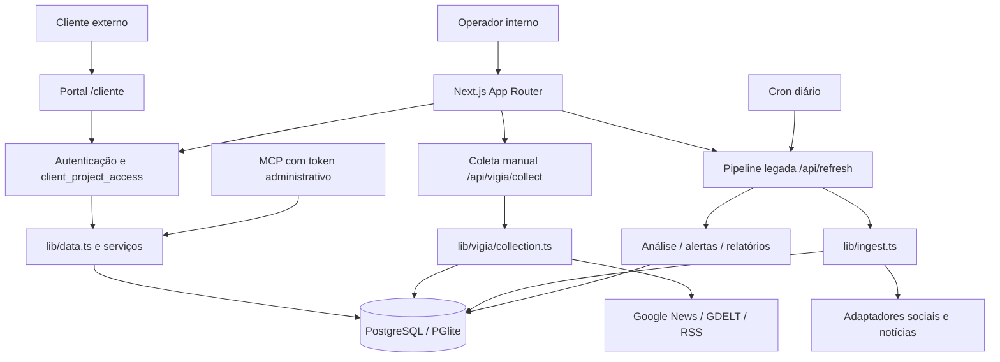

# VigiaElus — visão geral e arquitetura verificada

> Auditoria estática em 2026-11-09. Fonte: OARANHA/crises, HEAD `646b9f9d2e979d1e3fceb8fa639b5c89cd0d4afd`, branch `feat/vigiaelus-client-portal-scan-v8` (PR #3 DRAFT). Não representa estado do Windows, base operacional nem homologação em produção. **Não fazer merge/deploy por esta documentação.**

## Produto e situação

VigiaElus é uma aplicação de inteligência de reputação e social listening. Permite configurar projetos e fontes públicas, coletar menções, consultar indicadores, detectar tendências e alertas, analisar textos por IA e gerar relatórios/exportações. O piloto nominal é **CRF-RS — Reputação e Comunicação**, com três entidades: Giovana Ranquetat Fernandes, Funcionários CRF-RS e CRF-RS. Os perfis de Instagram são **termos públicos de pesquisa**, não coleta de publicações desses perfis no piloto.

O repositório tem desenvolvimento em PRs encadeadas, ainda draft:
- PR #1 `feat/vigiaelus-crfrs-etapas-1-2` (HEAD `e5751612`, base `fix/radar-homologacao-p0`): piloto, histórico e deduplicação.
- PR #2 `feat/vigiaelus-global-ui` (HEAD `57e6ab1c`, base PR #1): sistema visual dark/light.
- PR #3 `feat/vigiaelus-client-portal-scan-v8` (HEAD `646b9f9d`, base PR #2): portal cliente e scan/documentação.

A branch `main` (HEAD `875aac37` na auditoria) **não incorpora automaticamente essas três PRs**. Ao clonar, selecionar a branch adequada. CI do HEAD `646b9f9d`: execuções GitHub Actions `42415615373` e `42415611478` concluídas com sucesso em 2026-11-07. Isso é evidência de CI para aquele SHA, não homologação de coleta real ou deploy.

## Stack e organização

- Next.js 16.2.10 (App Router), React 19.2.4, TypeScript, Tailwind CSS 4, Lucide e Recharts.
- Banco PostgreSQL via Neon HTTP em `DATABASE_URL`; sem URL, PGlite em disco `.data/pglite`, via Drizzle ORM.
- Fontes em `lib/connectors/` (25 adaptadores; credenciais exigidas variam).
- Inteligência em `lib/claude.ts`, `lib/ai-provider.ts`, `lib/insights.ts` e módulos de análises correlatos; provedores configurados Anthropic, OpenAI, xAI e Azure OpenAI.
- Exportações DOCX, PDF, PPTX, XLSX em `app/api/export/`, com bibliotecas docx, PDFKit, pptxgenjs e ExcelJS.
- Servidor MCP HTTP somente leitura em `app/api/mcp`, com **token global administrativo**, não credencial de cliente.
- `app/`: páginas e APIs; `components/`: UI; `lib/db/`: schema e DDL; `tests/`: testes Node/tsx; `scripts/`: verificações; `docs/`: documentos e evidências.

### Arquitetura lógica atual

**Há dois percursos operacionais diferentes, que não devem ser confundidos.**

### Fluxo A — piloto CRF-RS (coleta manual)

1. Administrador autenticado chama `POST /api/vigia/pilot` para criação explícita/idempotente do piloto.
2. Operador autorizado solicita `POST /api/vigia/collect` com corpo JSON `{"projectId":123}`. Sem projeto explícito: 400; projeto sem autorização: 404; execução concorrente: 409.
3. `lib/vigia/collection.ts` consulta apenas `googlenews`, `gdelt` e feeds `rss` reais habilitados; fontes executadas em sequência.
4. Valida identificador/URL/data/entidade, deduplica por origem e URL canônica e registra menções, entidades, descobertas e histórico detalhado por fonte.
5. Exibe `success`, `partial` ou `failed` com contagens e diagnósticos em `/vigia`. **Não** chama IA, relatórios, alertas, notificações ou exclusão automática neste caminho.
6. A programação de um cliente a cada 15 minutos é uma meta funcional; **não está demonstrada pelo coletor manual**.

### Fluxo B — pipeline geral (herdada de Radar)

1. `POST /api/refresh` exige sessão válida e projeto autorizado; `GET /api/cron/daily` usa `CRON_SECRET`.
2. `lib/pipeline.ts` executa ingestão via `lib/ingest.ts`/adaptadores, enriquecimento, análises, tendências, alertas, briefs e notificações conforme configuração/IA.
3. A pipeline usa bloqueios em `meta` e trabalha projeto a projeto no cron geral.
4. Ao fim da rotina geral, **executa DELETE de menções coletadas há mais de 90 dias com `import_file_id IS NULL`**, mesmo sem exportação registrada. Esta característica é um **bloqueador P0**.
5. `vercel.json` agenda coleta diária às 05:00 UTC e relatórios às 07:00 UTC. **Não implementa quatro clientes por hora**.

## Principais módulos e telas

| Área | Código principal | Uso |
|---|---|---|
| Dashboard e listening | `app/`, `app/listening/page.tsx`, `lib/data.ts` | Indicadores, busca, filtros, menções |
| Piloto CRF-RS | `app/vigia/page.tsx`, `lib/vigia/{core,pilot,collection}.ts` | Fontes, resultados e histórico |
| Configurações e fontes | `app/settings/`, `app/impostazioni/fonti/` | Projetos, termos, credenciais, fontes |
| Administração de clientes | `app/clientes/page.tsx` | Criação de contas cliente e associação aos projetos |
| Portal externo | `app/cliente/`, `lib/client-portal.ts` | Dashboard e publicações autorizadas, leitura |
| Identidade e acesso | `proxy.ts`, `lib/{session,session-auth,auth,project-access,api-guard}.ts` | Sessões assinadas e autorização |
| Coleta geral | `lib/ingest.ts`, `lib/connectors/`, `lib/pipeline.ts` | Consultas e processamento periódico |
| Inteligência e relatórios | `lib/claude.ts`, `lib/ai-provider.ts`, `lib/alerts.ts`, `lib/periodic-report.ts` | Classificação, alertas e exports |
| MCP | `app/api/mcp/route.ts`, `lib/mcp.ts` | 11 ferramentas administrativas read-only |

## Autorização e fronteiras

`sr_session` é cookie `httpOnly` assinado em HMAC-SHA256, com `users.session_version` verificada no banco para revogação. `proxy.ts` faz apenas pré-filtro de assinatura; os guards/serviços devem verificar versão e permissões novamente.

- `admin`: vê todos os projetos; `member`: próprios e compartilhados; `client`: somente IDs atribuídos por `client_project_access`.
- APIs do portal resolvem o projeto a partir de `getProjects()` e recusam IDs inacessíveis; cliente externo é somente leitura.
- `/api/mcp` **não usa autorização de cliente**. Seu token global permite leitura transversal de projetos. Não expor esse token nem reutilizar MCP administrativo como API do portal.
- `DEMO_MODE=1` aplica modo de demonstração read-only, com guards em operações sensíveis.

## Documentos relacionados

- `docs/vigiaelus/technical-reference.md` — rotas, banco, configuração e execução.
- `docs/vigiaelus/audit-roadmap-2026-11-09.md` — achados com evidência, prioridade, esforço e aceite.
- `docs/vigiaelus-crfrs.md` — desenho original do piloto.
- `docs/architecture/target-architecture.md` — arquitetura-alvo SaaS; **não** confundir com arquitetura implantada.
- `docs/roadmap.md` — roadmap anterior.
- `.claude/pipeline/project-doc.md` — scan inicial de 07/11/2026.

## Estado de verificação

Auditoria estática do GitHub e inspeção do histórico da branch. Não foi validado o conteúdo existente em `D:\VIGIAELUS` ou `D:\CRISE_APP`, nem executada coleta real contra GDELT/Meta/Google News nesta auditoria. Evidências de testes do GitHub valem estritamente para os HEADs informados. A aprovação produtiva requer homologação real, segurança, integridade de dados e autorização expressa do proprietário.
