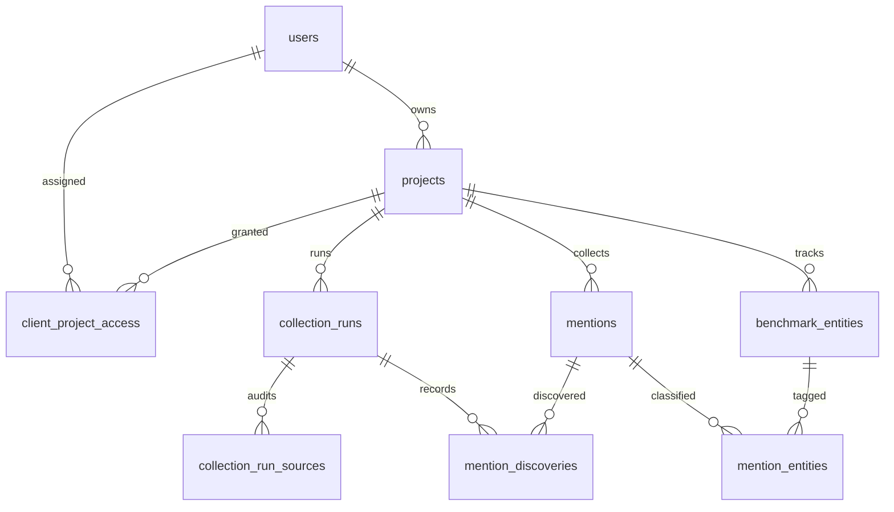

# VigiaElus — referência técnica operacional

> Revisão do código em 09/11/2026, `feat/vigiaelus-client-portal-scan-v8` / `646b9f9d2e979d1e3fceb8fa639b5c89cd0d4afd`. API descrita a partir de nomes de rota e handlers selecionados; **métodos não inspecionados individualmente devem ser confirmados no código** antes de integrações externas. Sem acesso comprovado ao Windows ou à base operacional.

## 1. Instalação e execução (Windows / PowerShell)

Pré-requisitos: Git, Node.js 22 (mesma major usada no CI), npm e acesso às fontes externas. Para uma pasta **nova**:

```powershell
cd D:\
git clone https://github.com/OARANHA/crises.git VIGIAELUS
cd D:\VIGIAELUS
git fetch origin
git switch --track origin/feat/vigiaelus-client-portal-scan-v8
git status --short --branch
git rev-parse HEAD
npm ci
Copy-Item .env.example .env.local
# Editar .env.local localmente, NUNCA enviar segredos ao Git
npm run dev
```

Abrir `http://localhost:3000` (porta padrão). Para usar a porta histórica `3100`: `npx next dev -p 3100`.

Se `D:\VIGIAELUS` **já existir**, não clonar por cima e não descartar alterações locais:

```powershell
cd D:\VIGIAELUS
git status --short --branch
git remote -v
git rev-parse HEAD
git branch --show-current
# Só depois de revisar arquivos não commitados:
git fetch origin
# A troca de branch só é segura se o Git não exigir sobrescrever alterações locais
```

Não copiar cegamente `.data/pglite` nem substituir `.env.local`: pode conter dados e segredos. Não usar `git reset --hard` / `git clean -fd` sobre `D:\CRISE_APP` ou `D:\VIGIAELUS` sem inventário, backup e autorização.

Testes disponíveis:

```powershell
npm run lint
npx tsc --noEmit
npm test
npm run build -- --webpack
# E2E de segurança somente após conferir ambiente de teste isolado:
node scripts/e2e-security.mjs
node scripts/e2e-server-actions.mjs
```

A suíte CI executa install, verificação documental, lint, TypeScript, testes, build webpack e E2E com PGlite isolado. `scripts/vigia-live-smoke.ts` faz consultas reais com PGlite descartável e **não deve ser considerado aceite automático de fonte**. Há custo de quota/limite de serviços externos.

## 2. Variáveis de ambiente

Arquivo base `.env.example`; o runtime usa `.env.local` em desenvolvimento. Colunas: **Obrig. em produção** indica política operacional recomendada, distinta da exigência que o código impõe hoje.

| Grupo | Variável | Função | Obrig. em produção |
|---|---|---|---|
| Banco | `DATABASE_URL` | PostgreSQL/Neon; ausente usa PGlite em `.data/pglite` | Recomendável para múltiplas instâncias |
| Banco local | `PGLITE_DIR` | Sobrescreve diretório PGlite, útil em testes isolados | Não |
| Sessão | `SESSION_SECRET` | Assinatura HMAC e derivação da chave de cifragem das credenciais | **Sim (exigido pelo código)** |
| Login inicial | `ADMIN_EMAIL`, `ADMIN_PASSWORD`, `ADMIN_NAME` | Primeiro admin se banco sem usuários | **Configurar senha forte; código ainda aceita default inseguro** |
| Cron | `CRON_SECRET` | Autorização Bearer para crons | **Sim (código fail-closed)** |
| App | `APP_URL` | URL usada em links de notificações | Recomendável |
| Interface | `NEXT_PUBLIC_BRAND_NAME`, `NEXT_PUBLIC_BRAND_BYLINE` | Marca visível no browser | Não |
| Demo | `DEMO_MODE` | Demo pública somente leitura | Nunca habilitar em instância real com dados confidenciais |
| IA | `ANTHROPIC_API_KEY`, `OPENAI_API_KEY`, `XAI_API_KEY` | Credenciais dos providers IA | Conforme provider ativo |
| IA | `AZURE_OPENAI_API_KEY`, `AZURE_OPENAI_ENDPOINT` | Azure OpenAI | Se usado |
| IA | `API_BUDGET_USD` | Teto mensal estimado | Recomendável |
| Notificação | `TELEGRAM_BOT_TOKEN`, `TELEGRAM_CHAT_ID` | Push e digest Telegram | Se usado |
| MCP admin | `RADAR_MCP_TOKEN` | Token administrativo global, endpoint fica OFF sem token | Somente se MCP habilitado |
| Talkwalker | `TALKWALKER_ACCESS_TOKEN`, `TALKWALKER_DAILY_CREDITS` | Credencial e limite estimado de créditos diários | Se usado |
| Meta | `META_ACCESS_TOKEN`, `INSTAGRAM_USER_ID`, `FACEBOOK_PAGE_ID` | Hashtags Instagram/páginas Facebook autorizadas | Se usado |
| X | `X_BEARER_TOKEN` | Busca X API | Se usado |
| TikTok | `TIKTOK_CLIENT_KEY`, `TIKTOK_CLIENT_SECRET` | Research API aprovada | Se usado |
| LinkedIn | `LINKEDIN_ACCESS_TOKEN`, `LINKEDIN_ORG_ID` | Posts da organização | Se usado |
| Fontes | `YOUTUBE_API_KEY`, `REDDIT_CLIENT_ID`, `REDDIT_CLIENT_SECRET` | YouTube e Reddit | Se usado |
| Notícias | `NEWSAPI_KEY`, `NEWSDATA_API_KEY` | Agregadores externos | Se usado |
| Outras | `PODCASTINDEX_API_KEY`, `PODCASTINDEX_API_SECRET`, `STACK_EXCHANGE_KEY`, `GITHUB_TOKEN`, `DISCORD_BOT_TOKEN`, `DISCORD_CHANNEL_IDS` | Fontes especializadas | Se usado |
| Enriquecimento | `TAVILY_API_KEY`, `GOOGLE_FACTCHECK_API_KEY`, `GOOGLE_PLACES_API_KEY`, `YELP_API_KEY` | Pesquisa, fact check e reviews | Se usado |
| Esporte/mercado | `FOOTBALL_DATA_API_KEY`, `ALPHA_VANTAGE_API_KEY` | Dados esportivos/mercado | Se usado |

**Drift detectado:** `OPENAI_API_KEY` e `XAI_API_KEY` são aceitas em `lib/connector-credentials.ts` e usadas em `lib/ai-provider.ts`, mas ausentes do `.env.example` inspecionado. Adicioná-las e manter inventário de variáveis testado no CI.

**Credenciais cifradas pela UI** são gravadas em `meta` em AES-256-GCM, com chave derivada de `SESSION_SECRET` (ou fallback fora da configuração segura). A rotação de `SESSION_SECRET` sem procedimento de recriptografia pode tornar credenciais antigas ilegíveis; `loadStore()` devolve objeto vazio em caso de erro. Evitar rotação sem plano de migração.

## 3. APIs — contratos verificados

| Método / rota | Controle | Resultado / observação |
|---|---|---|
| `POST /api/auth` | Credenciais de login; ações `logout`/`revokeAll` | Cookie HMAC `sr_session` com versão; redirecionamento do cliente para `/cliente` |
| `POST /api/vigia/pilot` | Admin, sessão válida, demo bloqueado | Cria/retorna piloto CRF-RS; `projectId`, nome, fontes |
| `POST /api/vigia/collect` | Admin ou proprietário; `projectId` obrigatório, demo bloqueado | Execução manual; IDs/contagens/status; 400/404/409/500 conforme falha |
| `GET /api/cliente/overview?projectId=N` | Somente cliente/admin + projeto permitido | KPIs, alertas, tópicos, últimas menções e brief; `Cache-Control: private, no-store` |
| `GET /api/cliente/mentions?projectId=N&page=1&q=...&source=...&days=...` | Somente cliente/admin + projeto permitido | Lista paginada de 40 itens e total; `private, no-store` |
| `POST /api/refresh` | Sessão e projeto autorizado, cliente bloqueado | Pipeline completa apenas do projeto corrente |
| `GET /api/cron/daily` | Bearer `CRON_SECRET` em produção | Pipeline completa em projetos, digest |
| `GET /api/cron/reports` | Bearer `CRON_SECRET` em produção | Executa edições de relatórios periódicos |
| `POST /api/mcp` | Token global `RADAR_MCP_TOKEN` | MCP Streamable HTTP, leitura administrativa de projetos |
| `GET /api/mcp` | Descoberta/estado | Identificação de endpoint; não expõe menções |

As seguintes rotas também existem em `app/api/`, mas seus contratos de request/response/verb deverão ser extraídos dos handlers antes de publicar OpenAPI: `ask`, `brief`, `compare`, `expand`, `influencer`, `locale`, `content-locale`, `playbook`, `pov`, `pov/translate`, `timeline`, `translate`, `facts/refresh`, `insights/causal`, `insights/clusters`, `report/comment`, `report/custom`, `report/periodic`, `report/schedule`, `import/agent`, `import/analyze`, `import/audit`, `import/files`, `import/normalized`, `import/preview`, `import/spotcheck`, `reviews/import`, `reviews/lookup-yelp`, `reviews/refresh`, `sport/lookup-team`, `sport/refresh`, `studio`, `studio/comment`, `studio/countries`, `studio/hooks`, `studio/kit`, `studio/refine`, `trials/refresh`, `wikipedia/lookup-page`, `wikipedia/refresh`, `export/docx`, `export/pdf`, `export/periodic`, `export/pptx`, `export/report`, `export/xlsx`, `admin/mcp-test`.

### MCP (administrativo, não cliente)

`lib/mcp.ts` registra 11 tools read-only: `radar_projects`, `radar_overview`, `radar_mentions`, `radar_trends`, `radar_narratives`, `radar_briefs`, `radar_kpis`, `radar_reliability`, `radar_fact_checks`, `radar_trials` e `radar_crosscheck`. `radar_projects` lista o arquivo global; resolução de projetos **não** verifica sessão/tenant cliente. Qualquer integração externa por cliente exige token por workspace/escopos e autorização por projeto; **não distribuir `RADAR_MCP_TOKEN`**.

## 4. Banco de dados — entidades e integridade

Código: `lib/db/schema.ts` (Drizzle) e `lib/db/index.ts` (DDL idempotente aplicado ao inicializar o DB). O snapshot analisado declara **36 tabelas**:

- **Acesso e configuração:** `users`, `projects`, `client_project_access`, `meta`, `api_usage`.
- **Listening e piloto:** `benchmark_entities`, `mentions`, `collection_runs`, `collection_run_sources`, `mention_entities`, `mention_discoveries`.
- **Inteligência:** `stories`, `alerts`, `briefs`, `trends`, `narratives`, `influencer_profiles`, `content_ideas`, `timeline_events`.
- **Compartilhamento e importação:** `share_links`, `import_files`, `import_rows`, `custom_reports`, `periodic_reports`, `metric_points`, `studio_charts`.
- **Fontes especializadas:** `review_sources`, `reviews`, `sport_sources`, `sport_matches`, `stock_prices`, `search_interest`, `wiki_pages`, `wiki_edits`, `fact_checks`, `clinical_trials`.

### Relações críticas



- `client_project_access`: PK composta `user_id, project_id` e FKs no SQL DDL; cliente só vê projetos atribuídos. No mapeamento Drizzle, ainda faltam declarações explícitas de PK/FK; alinhar schema ORM e DDL.
- `mentions`: relação com projeto; unique por `(project_id, source, external_id)`; `canonical_key` para colapso de URLs equivalentes no piloto.
- `collection_runs`: trigger, status, contagens, início/fim, erro. Índice parcial único para evitar dois `running` de mesmo projeto.
- `collection_run_sources`: origem, query, HTTP status, contagens de descartes/duplicatas, duração, último sucesso por fonte.
- `mention_discoveries`: linhagem de uma menção por execução/origem mesmo após deduplicação.
- `api_usage`: custos agregados **sem coluna de projeto/cliente**; impede orçamento/chargeback multicliente confiável na configuração atual.
- `meta`: estado/locks/credenciais globais; atenção à corrida em leitura→gravação.

### Migrações e armazenamento

`getDb()` instala driver Neon HTTP se `DATABASE_URL` não vazia; caso contrário PGlite em disco. `ensureSchema(db)` percorre uma lista de `CREATE TABLE IF NOT EXISTS`, `ALTER TABLE ... ADD COLUMN IF NOT EXISTS`, índices e ajustes históricos **a cada inicialização da instância**. Não é uma trilha de migrations versionada/transacional. Recomendações: migrations numeradas, checks de integridade e backup anterior ao deploy; homologar rollback com snapshot e sem perda de dados.

## 5. Integrações e comportamento

Adaptadores cadastrados em `lib/connectors/index.ts`: Google News, GDELT, Reddit, Bluesky, Mastodon, Hacker News, YouTube, Telegram, RSS, LinkedIn Web, Stack Exchange, GitHub, Discord, SEC EDGAR, arXiv, Lemmy, NewsData, Podcast Index, X, Instagram, Facebook, TikTok, LinkedIn, NewsAPI e Talkwalker.

- Google News: RSS por consultas e localidade; suporte pt-BR/BR.
- GDELT: endpoint DOC 2.0 `/api/v2/doc/doc`, 1 repetição após 6 s para 429/5xx/não JSON; isso **não comprova** estabilidade.
- RSS/Atom: permite URL http(s) definida no projeto. Falta bloqueio efetivo de IPs privados/loopback e validação de redirecionamentos contra SSRF.
- Instagram: hashtags da Meta Graph API, requer Business/Creator e permissões; **não equivale à leitura arbitrária dos perfis públicos**. Facebook: páginas autorizadas pelo token. Ambos fixam Graph `v21.0` e passam token na query URL.
- Talkwalker: crédito estimado global; contabilização carece de operação atômica/isolamento por cliente.
- APIs/fontes premium: ativação exige chave e permissões, não supor que conector cadastrado esteja funcional.

## 6. Fluxos de uso e operações

**Operador:** login → `/settings`/`/impostazioni/fonti` → projeto e fontes → `/vigia` ou `/listening` → consulta dos últimos dados → relatórios/alertas. No piloto, criação por `POST /api/vigia/pilot` e coleta por `POST /api/vigia/collect`; um botão de refresh legado usa pipeline geral e deve ser claramente diferenciado na UI.

**Administrador de clientes:** login → `/clientes` → criar `role=client` com senha temporária ≥12 e `must_change_password` → atribuir projetos explicitamente → cliente visualiza `/cliente` e `/cliente/publicacoes`.

**Automação hoje:** cron diário às 05:00 UTC para pipeline geral e cron relatórios às 07:00 UTC. **Cadência 4 clientes/hora não está implementada**; definir scheduler por projeto, leases atômicos e rota protegida/worker dedicado.

**Segurança operacional:** jamais expor token MCP, `SESSION_SECRET`, `CRON_SECRET` ou credenciais BYOK a browser; separar banco de desenvolvimento da produção; evitar habilitar `DEMO_MODE` em ambiente real. Restaurar backups e revisar migrações antes de implantar.

## 7. Provas exigidas para homologação

Registrar commit SHA, branch, versões Node/npm, resultado de lint/tsc/test/build/E2E, evidência de execução real por fonte, comparação de duas coletas, erros 429 e fallback, teste de isolamento cliente A/B, estados vazios, operação móvel/dark, configuração de cron por 15 minutos, não perda de dados com política de retenção, restauração do backup e testes de rotas sem autenticação. CI GREEN é requisito necessário, não suficiente.
